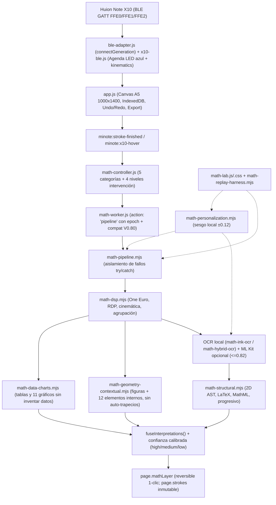

# Arquitectura Técnica — Mi Note Professional (Base V0.80 + Olas 1 y 2)

> Actualizado tras la integración de los commits verificados (`aa1cc70`, `61ad67b`, `9c0b4af`, `98d04e0`) y los módulos de Ola 2 (`math-personalization.mjs`, `math-replay-harness.mjs`, `math-lab.js/.css`, `math-pipeline.mjs`, `math-worker.js`).

---

## 1. Visión General y Compatibilidad V0.80

**Mi Note Professional** mantiene intacta la arquitectura **Android Capacitor 8.3.4 + Vite 7.1.12** (`cl.stikgatica.minote.x10`), el almacenamiento local **IndexedDB** (`MiNotePrivate`, esquema `mi-note-v1` con guarda anti-sobrescritura), el espacio de hoja A5 (`1000 × 1400`) y la capa secundaria reversible `page.mathLayer`.

Todos los módulos nuevos en `android-native/src/math/` son **ES Modules puros sin dependencias externas**, ejecutables en WebView Android, Web Worker y Node.js 22.

---

## 2. Arquitectura del Pipeline Unificado

---

## 3. Subsistemas Implementados y Endurecidos (Olas 1 y 2)

### 3.1 Endurecimiento BLE Huion Note X10 (`aa1cc70`)
- **`x10-ble.js`:** Corregido el descarte erróneo de tramas `0x8D` fragmentadas cuando el segundo fragmento inicia con `0xCD` o el primero tiene 1 byte; `parseNotePenFrames(value, limits)` respeta límites `0x95`; añadidos metadatos cinemáticos no destructivos (`sampleKinematics`, `mapPointWithMeta`, 4.º argumento opcional `meta` en `onPen`) preservando `[x, y, press]`.
- **`ble-adapter.js`:** Guarda `connectGeneration` anti-callbacks tardíos/notificaciones fantasma y deduplicación de `connect()` concurrentes (`connectingPromise`).
- **`offline-x10.js`:** Protección contra sobrescritura de un paquete `0x87` completo por un duplicado con menos puntos `pen_down` activos. Mantiene prohibición total de `0x8B`/`0x8C`.

### 3.2 Nuevos Módulos Matemáticos (`android-native/src/math/`)
| Módulo | Responsabilidad | Contrato / Restricciones Clave |
| :--- | :--- | :--- |
| `math-dsp.mjs` (`61ad67b`) | Suavizado One Euro (causal y zero-phase), media móvil, RDP, resampleo uniforme, Catmull-Rom/Bézier, normalización PCA, esquinas, overtracing, puntos accidentales y agrupación espacio-temporal. | Inmutable (verificado con `deepFreeze`), 0 deps. |
| `math-structural.mjs` (`9c0b4af`) | Analizador espacial 2D, parser AST/LaTeX/MathML (números, decimales, fracciones/anidadas, mixtos, potencias, raíces, porcentajes, razones, notación científica, aritmética vertical, álgebra, sistemas, funciones, pares ordenados, sucesiones), desambiguación contextual, reconocedor progresivo y `fuseInterpretations`. | Jamás autocorrige errores (`2+2=5`) ni resuelve ejercicios. |
| `math-geometry-contextual.mjs` (`98d04e0`) | Ajuste robusto (PCA, TLS/RANSAC, Kasa/Taubin, elipses, arcos, wireframes 3D) y 12 elementos internos contextuales (`radius`, `diameter`, `chord`, `altitude`, `median`, `angle_bisector`, `diagonal`, `right_angle_mark`, `congruence_ticks`, `arrow`, `auxiliary_line`, `attached_label`). | `EXCLUDED_AUTO_SHAPES = ['trapezoid']`; preserva proporciones (rectángulos jamás colapsados a cuadrados). |
| `math-data-charts.mjs` (`98d04e0`) | Tablas, tablas de frecuencia, gráficos de barras, histogramas, líneas, sectores, puntos, tallo-hoja, caja, árboles de probabilidad, rectas numéricas y planos cartesianos. | Solo preserva datos escritos (`null` para celdas/escalas no escritas). |
| `math-personalization.mjs` | Perfil local serializable (`UserHandwritingProfile`), prototipos normalizados, matriz de confusión, diccionario de símbolos frecuentes, sesgo acotado `±0.12` y sesiones de calibración guiada. | 100% local, anti prototype-pollution, sin trapecio en calibración. |
| `math-replay-harness.mjs` | Formato `RecordingSample` (`simulated` vs `huion-x10-hardware`), sanitización PII por lista blanca, aislamiento train/calibration vs evaluation por ID y huella, reproducción progresiva, `evaluateSuite` y generador determinista. | Distinción explícita hardware vs simulado; 0 mutación. |
| `math-lab.js` + `math-lab.css` | Panel de Laboratorio de Reconocimiento y Calibración (4 pestañas: Inspección, Corrección/Perfil, Calibración guiada, Regresión/Diagnóstico sin PII). | Integrable vía menú sin recargar la barra de escritura. |
| `math-pipeline.mjs` + `math-worker.js` | Orquestador unificado (`MATH_CATEGORIES`, `INTERVENTION_LEVELS`, `runMathPipeline`, `createProgressivePipeline`) + Worker con `action: 'pipeline'` y cancelación por `epoch`. | Aislamiento de fallos por sub-motor (`diagnostics.engineErrors`), tope ML Kit `<= 0.82`, compatibilidad V0.80 `automatic`/`propose`. |

---

## 4. Procedimiento de Actualización Segura de APK y Restauración

### Actualización Segura de APK (In-Place con Firma Permanente)
1. **Respaldo previo obligatorio:** Abrir **Más opciones → Exportar y respaldar → Respaldo JSON** (o confirmar **Copia privada cifrada en Google Drive** actualizada) y verificar que Android confirme el guardado fuera de la app.
2. **Compilación firmada en CI:** Hacer push autorizado a `main` para ejecutar `.github/workflows/android-release.yml`, que exige los secretos de firma permanente (`MINOTE_RELEASE_KEYSTORE_BASE64`, contraseñas, alias y `MINOTE_RELEASE_CERT_SHA256` validados por `scripts/signing-guard.mjs`).
3. **Instalación sin desinstalar:** Instalar el APK firmado sobre la V0.80 existente. Al compartir el mismo `appId` (`cl.stikgatica.minote.x10`) y certificado SHA-256, Android conserva IndexedDB (`MiNotePrivate`) intacto.
4. **Guarda de esquema:** Al iniciar, `app.js:449-451` verifica `state.schema === 'mi-note-v1'`; si detectara incompatibilidad, detiene el arranque sin sobrescribir ni borrar la base local.

### Procedimiento de Restauración / Rollback
1. Si tras actualizar se requiere volver a V0.80 o recuperar cuadernos en otro dispositivo:
   - Instalar el APK V0.80 firmado (desde GitHub Releases) o conservar la copia anterior.
   - Abrir **Más opciones → Importar archivo** (para respaldo JSON) o vincular la **Copia privada cifrada** en Google Drive introduciendo la contraseña de descifrado.
   - `mergeBackup()` combina cuadernos y páginas preservando cualquier conflicto bajo el sufijo `(conflicto importado)` sin sobrescribir notas locales.
2. **En caso de incidente en la X10 física:** Mientras no se ejecute el flujo explícito de limpieza con doble confirmación (`0x8B`/`0x8C`), la memoria interna de la Huion Note X10 permanece intacta y reimportable mediante `offline-x10.js`.
