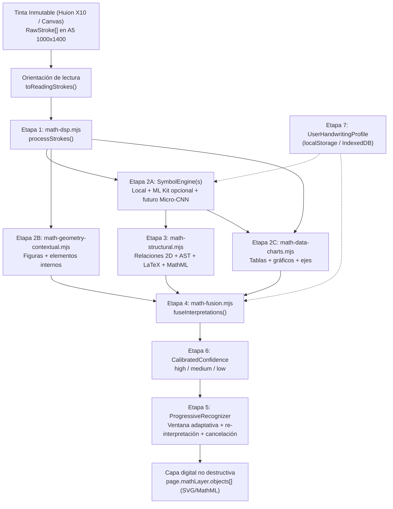

# Contrato del Motor de Reconocimiento — Mi Note Professional

**Proyecto:** Mi Note Professional (Android + Capacitor 8 + Huion Note X10)  
**Autor:** Agent 3 (`ai-researcher` — Especialista en IA y escritura manuscrita)  
**Relacionado:** [MODEL_COMPARISON.md](MODEL_COMPARISON.md)  
**Objetivo:** Definir el contrato exacto de interfaces, tipos de datos y flujo entre los módulos de reconocimiento (`math-dsp.mjs`, motores de símbolos/geometría/datos, `math-structural.mjs`, `math-fusion.mjs`, reconocedor progresivo, calibración de confianza y perfil de personalización), garantizando compatibilidad con V0.80 y ejecución pura en WebView, Web Worker y Node.js.

---

## 1. Principios invariantes del contrato

1. **Inmutabilidad estricta:** ninguna función del pipeline puede mutar `strokes`, `stroke.pts` ni objetos existentes de `page.mathLayer`. Toda transformación trabaja sobre copias o vistas derivadas.
2. **Espacio de coordenadas unificado:**
   - Almacenamiento en hoja A5: `x ∈ [0, 1000]`, `y ∈ [0, 1400]`.
   - Antes de analizar texto/matemática/tablas/gráficos, se proyecta a coordenadas de lectura mediante `toReadingStrokes(strokes, orientation)` (`src/ink-orientation.mjs`); las geometrías resultantes se proyectan de vuelta a hoja mediante `readingGeometryToPage(geometry, orientation)`.
3. **Fidelidad pedagógica (cero alucinación):**
   - El motor **transcribe**; nunca resuelve operaciones ni corrige errores matemáticos (`2 + 2 = 5` → `2 + 2 = 5`).
   - En tablas y gráficos, **solo** se digitalizan valores, ejes y etiquetas presentes en la tinta escrita.
   - En geometría automática, se **excluye** la clasificación automática de trapecios y **nunca** se fuerza un rectángulo a cuadrado.
4. **Degradación elegante offline:** el pipeline completo debe producir resultados válidos sin ningún plugin nativo ni red. ML Kit (`es`) es un adaptador opcional inyectable.
5. **Trazabilidad total:** toda hipótesis y objeto digital conserva `sourceStrokeIds: string[]` y `sources: Array<{ id: string, signature: string }>` (usando `fingerprint(stroke)` de `math-geometry.mjs`).

---

## 2. Arquitectura del Pipeline



---

## 3. Tipos base compartidos

Todos los módulos son ES Modules puros (`.mjs`) sin dependencias externas en runtime. Los tipos se documentan en formato TypeScript/JSDoc como contrato canónico:

```ts
/** Punto crudo compatible 100% con Mi Note V0.80. t es opcional (ms monotónicos). */
export type RawPoint = [x: number, y: number, press?: number, t?: number];

/** Trazo inmutable de Mi Note V0.80. */
export interface RawStroke {
  readonly id: string;
  readonly color?: string;
  readonly width?: number;
  readonly pts: readonly RawPoint[];
  readonly x10?: Record<string, unknown>;
}

export interface BBox {
  minX: number;
  minY: number;
  maxX: number;
  maxY: number;
  width: number;
  height: number;
  cx: number;
  cy: number;
  diag: number;
}

export type RecognitionCategory = 'auto' | 'numbers' | 'algebra' | 'geometry' | 'data';
export type ConfidenceLevel = 'high' | 'medium' | 'low';

export interface CalibratedScore {
  /** Probabilidad calibrada en [0, 1]. */
  score: number;
  /** Nivel discreto derivado de umbrales calibrados. */
  level: ConfidenceLevel;
  /** Brecha entre candidato #1 y candidato #2 en [0, 1]. */
  margin: number;
  /** Identificador de versión de calibración (ej. 'cal-v1'). */
  calibrationVersion: string;
  /** Desglose auditable de señales que contribuyeron al puntaje. */
  signals?: Record<string, number>;
}

export interface RankedCandidate<T> {
  value: T;
  confidence: CalibratedScore;
  engine: string;
  alternatives: Array<{ value: T; score: number; engine: string }>;
}

export interface StrokeSourceRef {
  id: string;
  signature: string;
}
```

---

## 4. Contratos por Etapa

### Etapa 1 — Procesamiento Digital de Trazos (`android-native/src/math/math-dsp.mjs`)

**Responsabilidad:** Limpiar, normalizar y extraer características cinemáticas/geométricas y agrupaciones espacio-temporales sin mutar `RawStroke[]`.

```ts
export interface DSPOptions {
  smoothing?: 'one-euro' | 'moving-average' | 'none';
  oneEuro?: { minCutoff?: number; beta?: number; dCutoff?: number };
  rdpEpsilon?: number;            // default adaptativo a escala
  resampleStep?: number;          // distancia uniforme de arco
  detectOvertracing?: boolean;    // default true
  detectAccidentalDots?: boolean; // default true
  groupTimeWindowMs?: number;     // ventana temporal adaptativa
  groupDistanceFactor?: number;   // factor relativo a altura mediana
}

export interface StrokeFeatures {
  id: string;
  orderIndex: number;
  bbox: BBox;
  arcLength: number;
  chordLength: number;
  straightness: number;           // chordLength / arcLength en [0, 1]
  closedness: number;             // distancia inicio-fin / diag
  isClosed: boolean;
  isDot: boolean;
  isAccidentalNoise: boolean;
  isOvertraced: boolean;
  mergedWithIds?: string[];
  aspectRatio: number;
  dominantAngleRad: number;       // orientación PCA o inicio-fin
  meanVelocity: number;           // 0 si no hay timestamps
  meanCurvature: number;
  corners: Array<{ index: number; x: number; y: number; angleRad: number }>;
  tStart: number | null;
  tEnd: number | null;
}

export interface ProcessedStroke {
  readonly id: string;
  readonly originalRef: RawStroke; // referencia intacta, nunca mutada
  points: Array<[number, number]>; // suavizado + simplificado/remuestreado
  resampled: Array<[number, number]>;
  simplified: Array<[number, number]>;
  features: StrokeFeatures;
}

export interface StrokeGroup {
  groupId: string;
  strokeIds: string[];
  strokes: ProcessedStroke[];
  bbox: BBox;
  tStart: number | null;
  tEnd: number | null;
  kindHint?: 'symbol' | 'line-row' | 'shape' | 'table-or-chart' | 'unknown';
}

export interface DSPResult {
  readonly original: readonly RawStroke[];
  processed: ProcessedStroke[];
  features: StrokeFeatures[];
  intersections: Array<{ aId: string; bId: string; point: [number, number] }>;
  groups: StrokeGroup[];
  medianStrokeHeight: number;
  timingMs: number;
}

export function processStrokes(
  strokes: readonly RawStroke[],
  options?: DSPOptions
): DSPResult;
```

---

### Etapa 2A — Motores de Símbolos (`SymbolEngine` — extensible)

**Responsabilidad:** Clasificar un subconjunto de trazos correspondiente a un símbolo o glifo individual (o renglón 1D en el adaptador ML Kit) devolviendo candidatos ordenados con `strokeIds` exactos.

```ts
export interface SymbolToken {
  tokenId: string;
  symbol: string;                 // ej. '3', '+', 'x', '×', '√', 'frac_bar', 'π', '='
  roleHint?: 'digit' | 'letter' | 'operator' | 'relation' | 'punctuation' | 'delimiter' | 'radical' | 'bar' | 'unit';
  bbox: BBox;
  strokeIds: string[];
  confidence: CalibratedScore;
  alternatives: Array<{ symbol: string; score: number }>;
  engine: 'local-vector' | 'local-hybrid' | 'mlkit-es' | 'micro-cnn-int8';
}

export interface SymbolEngine {
  readonly id: string;
  readonly supports2D: boolean;
  readonly offlineReady: boolean;
  isAvailable(): Promise<boolean> | boolean;
  recognizeGroup(
    group: StrokeGroup,
    dsp: DSPResult,
    context?: { category?: RecognitionCategory; profile?: UserHandwritingProfile }
  ): Promise<SymbolToken[]> | SymbolToken[];
}
```

- **Implementación base (offline inmediato):** evolución de `math-ink-ocr.mjs` combinando rasgos cinemáticos/direccionales (`math-dsp.mjs`) + plantillas/contorno + sesgo acotado del `UserHandwritingProfile`.
- **Adaptador opcional (`mlkit-adapter.mjs`):** envuelve `MiNoteCalendarPlugin.recognize()` solo para respaldo 1D cuando `modelStatus().downloaded === true`, sin bloquear ni vetar estructuras 2D.
- **Extensión futura (V1.x):** micro-clasificador INT8 (`micro-cnn-int8`) que implementa exactamente `SymbolEngine`.

---

### Etapa 2B — Motor de Geometría Contextual (`android-native/src/math/math-geometry-contextual.mjs`)

**Responsabilidad:** Reconocer figuras 2D/3D básicas con ajuste robusto (Kasa/Taubin, mínimos cuadrados, PCA, resistencia a outliers) y **elementos internos contextuales** respecto a figuras ya existentes en la hoja.

```ts
export type GeometryShapeKind =
  | 'line' | 'segment' | 'ray' | 'parallel-lines' | 'perpendicular-lines'
  | 'angle' | 'triangle' | 'square' | 'rectangle' | 'rhombus' | 'parallelogram'
  | 'polygon' | 'circle' | 'ellipse' | 'arc'
  | 'cube' | 'prism' | 'cylinder' | 'pyramid';
// NOTA: 'trapezoid' NO se emite nunca en modo automático (solo intención explícita futura).

export type ContextualElementKind =
  | 'radius' | 'diameter' | 'chord' | 'altitude' | 'diagonal'
  | 'angle-from-vertex' | 'bisector' | 'median'
  | 'right-angle-mark' | 'congruence-tick' | 'arrow' | 'auxiliary-line' | 'attached-label';

export interface GeometryHypothesis {
  domain: 'geometry';
  kind: GeometryShapeKind | ContextualElementKind;
  isContextual: boolean;
  parentObjectId?: string;        // presente si es elemento interno contextual
  label: string;                  // etiqueta humana en español (ej. 'Rectángulo', 'Radio')
  geometry: {
    kind: 'line' | 'polygon' | 'circle' | 'ellipse' | 'arc' | 'segments' | 'text';
    [prop: string]: unknown;
  };
  metrics?: {
    anglesDeg?: number[];
    sideLengths?: number[];
    aspectRatio?: number;
    isParallel?: boolean;
    isPerpendicular?: boolean;
  };
  sourceStrokeIds: string[];
  confidence: CalibratedScore;
  alternatives: Array<{ kind: string; label: string; score: number; geometry?: unknown }>;
}

export function analyzeGeometry(
  dsp: DSPResult,
  existingObjects?: readonly Record<string, unknown>[],
  options?: {
    intention?: string;           // 'auto' o intención explícita de DRAW_INTENTIONS
    allowAutoTrapezoid?: false;   // bloqueado a false por contrato
    preserveProportions?: true;   // bloqueado a true: rectángulo nunca se fuerza a cuadrado
  }
): GeometryHypothesis[];
```

---

### Etapa 2C — Motor de Datos, Tablas y Gráficos (`android-native/src/math/math-data-charts.mjs`)

**Responsabilidad:** Detectar estructuras de datos y gráficos estadísticos y convertirlos a modelos digitales editables **conservando exclusivamente lo escrito**.

```ts
export type DataVisualKind =
  | 'table' | 'frequency-table' | 'bar-chart' | 'histogram' | 'line-chart'
  | 'pie-chart' | 'dot-plot' | 'stem-and-leaf' | 'box-plot'
  | 'probability-tree' | 'number-line' | 'cartesian-plane';

export interface DataVisualHypothesis {
  domain: 'data';
  kind: DataVisualKind;
  label: string;
  structure: {
    // Estructura editable específica del tipo (filas/columnas/celdas, ejes/marcas/barras/puntos)
    rows?: number;
    cols?: number;
    cells?: Array<{ row: number; col: number; bbox: BBox; text: string | null; strokeIds: string[] }>;
    axes?: { x?: unknown; y?: unknown };
    series?: unknown[];
    points?: Array<{ x: number; y: number; label: string | null; strokeIds: string[] }>;
    /** Bandera verificable: nunca se sintetizan valores ausentes. */
    onlyWrittenDataPreserved: true;
  };
  bbox: BBox;
  sourceStrokeIds: string[];
  confidence: CalibratedScore;
  alternatives: Array<{ kind: DataVisualKind; label: string; score: number }>;
}

export function analyzeDataVisual(
  dsp: DSPResult,
  symbolTokens?: readonly SymbolToken[],
  options?: { category?: RecognitionCategory }
): DataVisualHypothesis[];
```

---

### Etapa 3 — Motor Estructural Matemático 2D (`android-native/src/math/math-structural.mjs`)

**Responsabilidad:** Construir relaciones espaciales 2D, desambiguar símbolos por contexto, generar AST + LaTeX + MathML, y transcribir fielmente sin corregir errores ni resolver.

```ts
export type SpatialRelationType =
  | 'right' | 'above' | 'below' | 'superscript' | 'subscript'
  | 'inside-radical' | 'fraction-numerator' | 'fraction-denominator'
  | 'multiline-next' | 'vertical-column';

export interface MathASTNode {
  type:
    | 'Number' | 'Variable' | 'Operator' | 'BinaryExpr' | 'UnaryExpr'
    | 'Fraction' | 'MixedNumber' | 'Power' | 'Subscript' | 'Radical'
    | 'Percentage' | 'Ratio' | 'ScientificNotation' | 'Group'
    | 'Equation' | 'Inequality' | 'System' | 'FunctionCall'
    | 'OrderedPair' | 'Sequence' | 'VerticalArithmetic' | 'Unknown';
  value?: string;
  children?: MathASTNode[];
  numerator?: MathASTNode;
  denominator?: MathASTNode;
  base?: MathASTNode;
  exponent?: MathASTNode;
  index?: MathASTNode;
  radicand?: MathASTNode;
  strokeIds: string[];
  bbox?: BBox;
}

export interface DisambiguationRecord {
  tokenId: string;
  candidates: string[];
  chosen: string;
  reason: string; // ej. 'between-digits:×', 'algebra-context:x', 'spans-numerator-and-denominator:fraction-bar'
}

export interface StructuralHypothesis {
  domain: 'math';
  category: 'numbers' | 'algebra';
  ast: MathASTNode;
  latex: string;
  mathml: string;
  plainText: string;
  relations: Array<{ fromId: string; toId: string; type: SpatialRelationType; score: number }>;
  disambiguations: DisambiguationRecord[];
  /** Garantía contractual: jamás corrige errores matemáticos ni evalúa resultados. */
  preservedAsWritten: true;
  sourceStrokeIds: string[];
  bbox: BBox;
  confidence: CalibratedScore;
  alternatives: Array<{ plainText: string; latex: string; score: number }>;
}

export function parseMathStructure(
  tokens: readonly SymbolToken[],
  dsp: DSPResult,
  options?: {
    category?: RecognitionCategory;
    profile?: UserHandwritingProfile;
  }
): StructuralHypothesis | null;
```

---

### Etapa 4 — Fusión Multi-Motor (`math-fusion.mjs` / `fuseInterpretations`)

**Responsabilidad:** Resolver competencia entre dominios (`math` vs `geometry` vs `data`) y entre motores (`local` vs `mlkit-es` vs futuro `micro-cnn`) sobre el mismo conjunto de trazos.

```ts
export type AnyHypothesis = StructuralHypothesis | GeometryHypothesis | DataVisualHypothesis;

export interface FusionContext {
  activeCategory: RecognitionCategory; // 'auto' | 'numbers' | 'algebra' | 'geometry' | 'data'
  intention?: string;                  // intención explícita de figura si aplica
  existingObjects?: readonly Record<string, unknown>[];
  temporalOrder?: string[];            // strokeIds en orden cronológico
  profile?: UserHandwritingProfile;
  mlkitCandidates?: string[];          // opcional, si ML Kit está descargado
}

export interface FusionDecision {
  winner: AnyHypothesis | null;
  action: 'auto-apply' | 'suggest' | 'keep-handwriting';
  confidence: CalibratedScore;
  alternatives: AnyHypothesis[];
  rejectedReasons: Array<{ domain: string; kind?: string; reason: string }>;
}

export function fuseInterpretations(
  hypotheses: readonly AnyHypothesis[],
  context: FusionContext
): FusionDecision;
```

**Reglas de fusión deterministas:**
1. **Prioridad de categoría/intención activa:** si el docente eligió `geometry` o una figura explícita (salvo `auto`), las hipótesis de ese dominio reciben peso prioritario y nunca se convierten en texto espurio.
2. **Validez estructural antes que similitud local:** una estructura 2D coherente (ej. fracción completa `numerador + barra + denominador` o tabla con cuadrícula regular) supera a lecturas 1D fragmentadas de ML Kit.
3. **Resolución de conflictos geométricos vs matemáticos:**
   - Una barra horizontal con dígitos arriba y abajo → `fraction-bar`, no `segment`.
   - Un círculo grande (`diag >= 52`) con un número dentro → `circle` + etiqueta/anotación, no `0` ni operación aritmética (`enclosedMathAnnotation`).
   - Dos trazos horizontales cortos al final de una expresión → `=`, no `parallel-lines`.
4. **Acuerdo entre motores:** cuando dos fuentes independientes coinciden (ej. local + ML Kit en aritmética 1D), se aplica un refuerzo calibrado acotado; cuando discrepan, **nunca** se autoconvierte (pasa a `suggest` con ambas alternativas visibles).

---

### Etapa 5 — Reconocedor Progresivo (`ProgressiveRecognizer`)

**Responsabilidad:** Manejar escritura incremental en vivo desde la Huion Note X10 (incluyendo trazos fuera de orden, como `3 → barra → 4 → + → 1/2`), evitar transformaciones prematuras y cancelar trabajos obsoletos.

```ts
export type ProgressiveState = 'idle' | 'collecting' | 'settling' | 'ready' | 'superseded';

export interface ProgressiveConfig {
  basePauseMs?: number;           // ej. 550 ms geometría, 1100–1600 ms matemática
  adaptiveFactor?: number;        // ajusta pausa según cadencia reciente del docente
  maxGroupStrokes?: number;       // límite seguro por grupo (ej. 80)
  reopenWindowMs?: number;        // ventana para re-interpretar si llegan nuevos trazos cercanos
}

export interface ProgressiveRecognizer {
  getState(): ProgressiveState;
  /** Registra un trazo finalizado (inmutable) y retorna el nuevo jobId/epoch. */
  onStrokeFinished(stroke: RawStroke, nowMs?: number): { epoch: number; settleDelayMs: number };
  /** Cancela cualquier análisis en curso (ej. cambio de página, categoría o nuevo trazo). */
  cancel(reason?: string): void;
  /** Evalúa el grupo activo al cumplirse la pausa natural; ignora resultados de epochs obsoletos. */
  evaluateIfCurrent(epoch: number, runner: () => Promise<FusionDecision>): Promise<FusionDecision | null>;
  /** Permite re-agrupar y re-interpretar un objeto automático si llega un trazo espacialmente relacionado. */
  shouldReinterpret(existingStrokeIds: string[], incomingStroke: RawStroke, dsp: DSPResult): boolean;
}
```

---

### Etapa 6 — Confianza Calibrada (`CalibratedConfidence`)

Para evitar sobreconfianza (puntajes artificialmente cercanos a `0.99`) y unificar motores con escalas heterogéneas:

| Nivel | Rango `score` | Margen mínimo (`top1 - top2`) | Acción por defecto en UI (`action`) |
| :--- | :---: | :---: | :--- |
| **`high`** | `>= 0.85` | `>= 0.12` | `auto-apply` (solo si el modo automático está activo y sin ambigüedad crítica `0/8` ni contradicción entre motores) |
| **`medium`** | `0.55 – 0.84` | `>= 0.04` (o discrepancia) | `suggest` (mostrar propuesta editable + alternativas ordenadas; la tinta sigue intacta hasta confirmación) |
| **`low`** | `< 0.55` | cualquiera | `keep-handwriting` (no interrumpir ni sustituir la tinta) |

**Reglas de calibración:**
- Cada motor reporta puntajes normalizados en `[0, 1]` más el margen contra el segundo mejor candidato.
- Se aplica escalado logístico/temperatura por motor (`calibrationVersion: 'cal-v1'`) y penalización explícita ante ambigüedades conocidas (`0/8`, `1/l`, `x/×`, trazos demasiado pequeños o incompletos).
- ML Kit nunca recibe `score > 0.82` por sí solo (porque no expone probabilidad calibrada); para alcanzar `auto-apply` en aritmética 1D requiere acuerdo con el motor local o validación estructural completa sin dígitos dudosos.

---

### Etapa 7 — Perfil de Personalización Local (`UserHandwritingProfile`)

**Responsabilidad:** Adaptarse progresivamente al estilo de escritura del docente (ej. cómo traza el `4`, el `7` con barra, la `x` curva vs `×`) **100% en el dispositivo**, sin red y reversible en un clic.

```ts
export interface UserHandwritingProfile {
  version: 1;
  enabled: boolean;
  updatedAt: string;
  /** Conteo de correcciones confirmadas por el usuario: confusions["predicted->actual"] = count */
  confusionMatrix: Record<string, number>;
  /** Prototipos vectoriales resumidos (16-24 puntos normalizados) por símbolo, máx. 3 por símbolo. */
  symbolPrototypes: Record<string, Array<{
    points: Array<[number, number]>;
    strokeCount: number;
    aspectRatio: number;
    samples: number;
  }>>;
  /** Preferencias observadas (ej. separador decimal ',' vs '.', estilo de división ':' vs '÷'). */
  preferences: {
    decimalSeparator?: ',' | '.';
    divisionSymbol?: '÷' | ':';
    multiplicationSymbol?: '×' | '·';
  };
  /** Sesgo máximo permitido en fusión/clasificación para nunca forzar lecturas absurdas. */
  maxBiasDelta: 0.12;
}
```

- **Almacenamiento:** `localStorage` / `IndexedDB` local del dispositivo (exportable opcionalmente en el respaldo privado cifrado existente si el usuario lo desea, nunca en texto plano externo).
- **Límite de seguridad:** el perfil solo puede ajustar el puntaje de un candidato en `±0.12` (`maxBiasDelta`), de modo que jamás sobrescribe una evidencia geométrica o estructural clara.
- **Control del usuario:** opción explícita "Restablecer aprendizaje de escritura" que borra el perfil sin tocar ningún cuaderno ni trazo.

---

## 5. Protocolo del Web Worker (`math-worker.js`) y compatibilidad V0.80

Para no romper `math-controller.js` ni las pruebas existentes durante la integración incremental:

1. **Compatibilidad hacia atrás:** `action: 'automatic'` y `action: 'propose'` siguen funcionando sin cambios de firma.
2. **Nueva acción unificada `action: 'pipeline'`:**
   - **Request:**
     ```js
     {
       id: number,
       jobId: string,
       epoch: number,
       action: 'pipeline',
       strokes: RawStroke[],
       existingObjects: MathLayerObject[],
       orientation: 'portrait' | 'landscape-cw' | 'landscape-ccw',
       category: 'auto' | 'numbers' | 'algebra' | 'geometry' | 'data',
       intention: string,
       profile?: UserHandwritingProfile,
       mlkitCandidates?: string[] // opcional, pre-consultado en hilo principal si aplica
     }
     ```
   - **Response:**
     ```js
     {
       id: number,
       jobId: string,
       epoch: number,
       result: FusionDecision,
       timingMs: number
     }
     ```
3. **Mapeo a `page.mathLayer.objects[]` (V0.80 → V1.0):**
   Cada objeto aceptado mantiene el esquema base de V0.80 (`id`, `accepted`, `automatic`, `type`, `label`, `geometry`, `style`, `sources`, `labels`) y puede incluir metadatos aditivos opcionales sin romper lectores antiguos:
   - `domain`: `'math' | 'geometry' | 'data'`
   - `latex?`, `mathml?`, `ast?` (para expresiones 2D)
   - `structure?` (para tablas y gráficos editables)
   - `parentObjectId?`, `contextualKind?` (para elementos internos de figuras)
   - `confidence?`: `CalibratedScore`

---

## 6. Resumen de propiedad por módulo del Swarm

| Módulo | Agente responsable | Entrada principal | Salida principal |
| :--- | :--- | :--- | :--- |
| `src/math/math-dsp.mjs` | Agent 2 (`stroke-dsp`) | `RawStroke[]`, `DSPOptions` | `DSPResult` |
| `src/math/math-structural.mjs` | Agent 4 (`math-struct`) | `SymbolToken[]`, `DSPResult` | `StructuralHypothesis`, `ProgressiveRecognizer`, `fuseInterpretations` |
| `src/math/math-geometry-contextual.mjs` | Agent 5 (`geometry-pro`) | `DSPResult`, `existingObjects` | `GeometryHypothesis[]` |
| `src/math/math-data-charts.mjs` | Agent 6 (`geometry-pro`) | `DSPResult`, `SymbolToken[]` | `DataVisualHypothesis[]` |
| `docs/swarm/MODEL_COMPARISON.md` & `RECOGNITION_ENGINE.md` | Agent 3 (`ai-researcher`) | Auditoría V0.80 + investigación | Arquitectura y contrato compartido |
